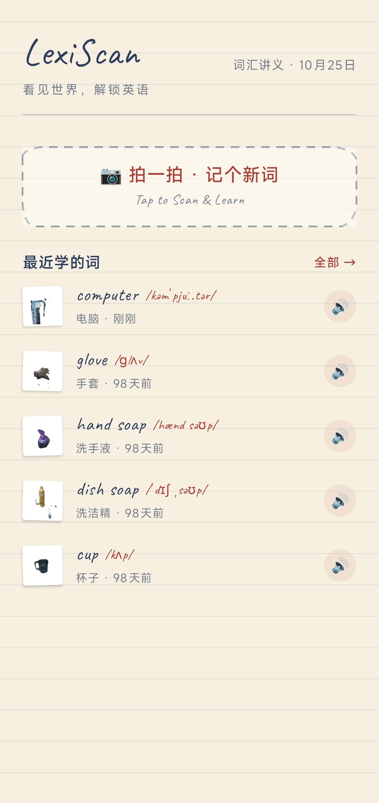

# LexiScan · 撕拉识物

> 拍一拍，撕一撕，认识身边的英语单词 —— 一个用 AI VibeCoding 完成的 Android 英语学习应用。



LexiScan 把「拍照识物」和「单词学习」装进一本**教授讲义**里：对准物品拍一张，应用先用本地 U2-Net 模型把物品从背景里"撕"出来（仿 CapWords 撕拉动画），再交给视觉大模型识别、LLM 标准化，最后以图钉双线框标本卡的形式，把英文单词、音标、词性、复数和例句写在米色讲义纸上。

## 核心特性

- **本地图像分割** —— U2-Net TFLite 完全离线运行，抠出透明前景 PNG，撕拉动画配合震动反馈掩盖识别等待
- **两步大模型识别** —— 硅基流动 Qwen3-VL 视觉识图（输出中文物品名）→ DeepSeek LLM 标准化（英文单词 + 英式音标 + 词性 + 复数 + 儿童友好例句），失败自动回退 dictionaryapi.dev 查音标
- **教授讲义视觉** —— 米色横线纸 + 蓝黑钢笔字 + 红笔批注；英文手写字体 Caveat（OFL 开源）；主页生词表直接陈列最近 5 个新词，点击原地发音
- **TTS 发音 + 历史记录** —— Android TextToSpeech 朗读单词；JSON 文件持久化全部识别记录，可回看详情

## 识别工作流

```
拍照 / 选图
    │
    ▼
U2-Net 本地分割（离线，透明前景 PNG）
    │
    ▼
前景合成白底图 + Base64 ──► Qwen3-VL 视觉识图（硅基流动）──► 中文物品名
    │
    ▼
DeepSeek LLM 标准化 ──► 英文单词 · 音标 · 词性 · 复数 · 例句
    │                     （失败回退 dictionaryapi.dev 音标兜底）
    ▼
JSON 文件持久化 ──► 结果页标本卡展示 / 主页生词表
```

## 技术栈

Kotlin · Jetpack Compose + Material 3 · CameraX · TensorFlow Lite (U2-Net) · Retrofit + OkHttp · SiliconFlow Qwen3-VL · DeepSeek API · Android TTS · Coil · Gson。最低支持 Android 12（API 31）。

## 快速开始

1. 克隆仓库，用 Android Studio（JDK 17）打开。
2. **配置 API 密钥**：在项目根目录的 `local.properties`（已被 .gitignore 忽略，不会提交）中添加：

   ```properties
   SILICONFLOW_API_KEY=你的 SiliconFlow 密钥
   DEEPSEEK_API_KEY=你的 DeepSeek 密钥
   ```

   密钥由 Gradle 编译期注入 `BuildConfig`，源码与仓库中不含任何真实密钥。密钥可在 [SiliconFlow](https://cloud.siliconflow.cn/) 与 [DeepSeek 平台](https://platform.deepseek.com/) 申请。

3. 构建运行：

   ```bash
   ./gradlew :app:assembleDebug        # Windows: .\gradlew.bat :app:assembleDebug
   ```

   APK 输出在 `app/build/outputs/apk/debug/`。真机或 Android 12+ 模拟器均可运行（如 MuMu 12：`adb connect 127.0.0.1:16384` 后 `adb install -r app-debug.apk`）。

## 项目结构（节选）

```
IIE/
├── app/src/main/
│   ├── assets/u2netp.tflite              # U2-Net 分割模型（离线打包）
│   ├── font/caveat.ttf                   # Caveat 英文手写字体
│   └── java/com/example/lexiscan/
│       ├── data/Service/                 # API 配置、DeepSeek、识图 Provider
│       ├── data/segmentation/            # U2-Net TFLite 分割核心
│       ├── ui/components/PaperComponents.kt  # 讲义纸风共享组件
│       ├── ui/screens/                   # 首页 / 相机 / 结果 / 历史
│       └── viewmodel/                    # 识别工作流编排
├── sam2_server/                          # SAM2 Python 分割服务端（备选方案）
├── IIE客户端app_vibecoding提示词/          # VibeCoding 全过程提示词存档
└── docs/superpowers/specs/               # 设计文档
```

## 关于 VibeCoding

本项目是一次完整的 AI 协作编程实践：需求 → 视觉方案选型 → 设计文档 → 实现，全程由 AI 结对完成。提示词与迭代记录保存在 `IIE客户端app_vibecoding提示词/` 目录，设计决策记录在 `docs/superpowers/specs/2026-10-24-lecture-notes-restyle-design.md`。

## 许可

本项目仅供学习交流使用。
